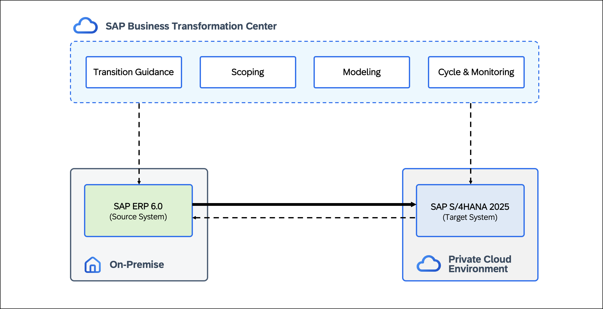

# BT164 - Accelerate your cloud transition with the SAP Cloud ALM solution

## Description

This repository contains the material for the SAP TechEd 2026 session called BT164 - Accelerate your cloud transition with the SAP Cloud ALM solution.  

## Overview

This hands-on session shows how to transition from <b>SAP ERP 6.0</b> to <b>SAP Cloud ERP Private</b> using <b>SAP Business Transformation Center</b> (BTC). It provides a practical introduction to the tools and concepts that support a data-driven transformation journey.

During the session, you will execute a <b>Selective Data Transition</b> utilizing three solution patterns: the organizational slice, the time slice, and the chart of accounts mapping, enabling a <b>smooth</b> and <b>data-driven</b> move to <b>SAP Cloud ERP Private</b>.

  

## Requirements
To complete the exercises in this hands-on session, you need **SAP GUI** and a **web browser** (preferably **Google Chrome**).  

## Exercises

Building on the concepts introduced above, the following exercises take you through <b>each phase</b> of a <b>data-driven transition</b> using <b>SAP Business Transformation Center</b> — from <b>scoping</b> via <b>modeling</b> to <b>executing</b>.

Step by step, you will analyze your <b>system data</b>, scope and define your transformation project, and <b>execute the transition</b> to <b>SAP Cloud ERP Private</b> in a lean and controlled way.

Below you find an overview of all exercises included in this hands-on session:

- [Scenario Overview](exercises/ex0/)
- [Exercise 1 - Build the Foundation: Upload UDP File](exercises/ex1/)
- [Exercise 2 - Initialize Project: Create Digital Blueprint](exercises/ex2/)
- [Exercise 3 - Scope the Blueprint: Select & Reduce Data - Part 1/2](exercises/ex3/)
- [Exercise 4 - Chart of Accounts Mapping: Manage Value Mappings](exercises/ex4/)
- [Exercise 5 - Chart of Accounts Mapping: Value Mapping Versions](exercises/ex5/)
- [Exercise 6 - Scope the Blueprint: Select & Reduce Data - Part 2/2](exercises/ex6/)
- [Exercise 7 - Build the Model: Create Transformation Model & Version](exercises/ex7/)
- [Exercise 8 - Initialize Cycle: Create Cycle & Run Prevalidation](exercises/ex8/)
- [Exercise 9 - Execute Blueprint: Review Reference Cycle](exercises/ex9/)

 
 

## Contributing
Please read the [CONTRIBUTING.md](./CONTRIBUTING.md) to understand the contribution guidelines.

## Code of Conduct
Please read the [SAP Open Source Code of Conduct](https://github.com/SAP-samples/.github/blob/main/CODE_OF_CONDUCT.md).

## How to obtain support

Support for the content in this repository is available during the actual time of the online session for which this content has been designed. Otherwise, you may request support via the [Issues](../../issues) tab.

## License
Copyright (20xx-)20xx SAP SE or an SAP affiliate company and <your-project> contributors. Please see our [LICENSE](LICENSE) for copyright and license information. Detailed information including third-party components and their licensing/copyright information is available [via the REUSE tool](https://api.reuse.software/info/github.com/SAP/<your-project>).
